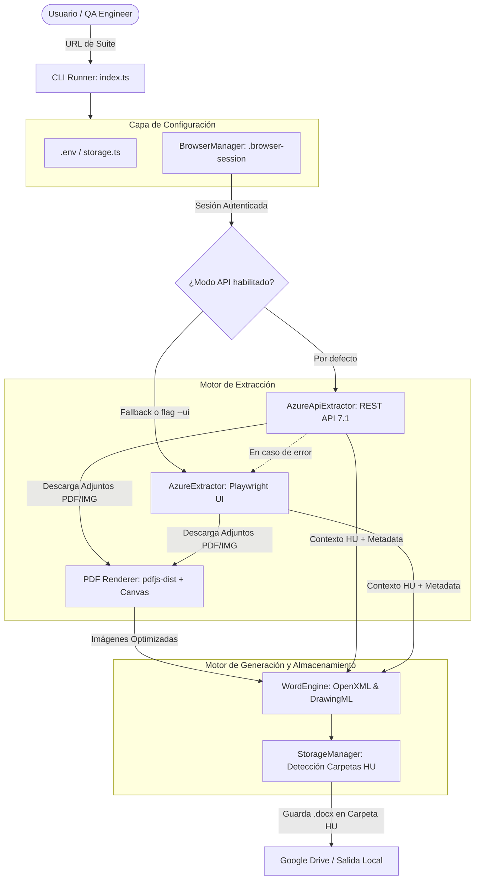
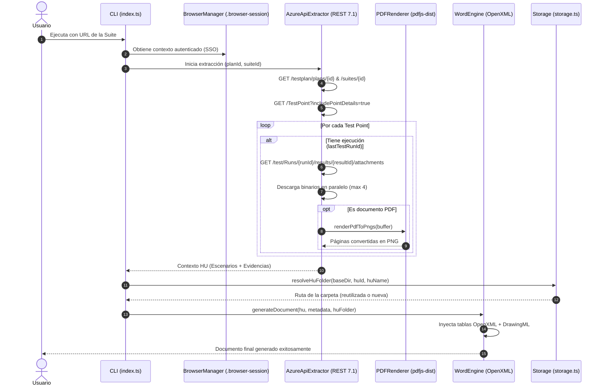

# Arquitectura del Sistema: Azure DevOps Test Reporter

Este documento describe la arquitectura técnica, los componentes clave y el flujo de datos del **Azure DevOps Test Reporter**, una solución híbrida de alto rendimiento diseñada para extraer resultados de pruebas, evidencias y adjuntos de **Azure Test Plans** y compilar informes oficiales en formato **Microsoft Word (.docx)**.

---

## 1. Principios de Diseño

1. **Estrategia de Extracción Híbrida (API-First con Fallback UI):**
   * **Modo Primario (REST API 7.1):** Realiza llamadas HTTP concurrentes utilizando las cookies de la sesión del navegador para consultar suites, puntos de prueba y descargar adjuntos en paralelo sin interacción con la interfaz visual.
   * **Modo Respaldo (Playwright UI):** Si la API no está disponible o las políticas de red bloquean las solicitudes REST, el sistema activa automáticamente la navegación emulada mediante Playwright para interactuar con la interfaz de Azure DevOps.
2. **Autenticación sin Secretos (Persistencia de Sesión SSO):**
   * El sistema no almacena tokens personales (PAT), contraseñas ni secretos en código o archivos de configuración.
   * Utiliza un contexto de navegador persistente (`.browser-session`) mediante `launchPersistentContext()`. El usuario inicia sesión una única vez vía Microsoft Entra ID / MFA y la sesión se reutiliza transparentemente.
3. **Procesamiento de Evidencias Multiformato:**
   * **Imágenes (PNG / JPEG):** Redimensionadas de forma reactiva al ancho útil exacto de la celda de la tabla (`evidenceCellWidthDxa`) preservando su relación de aspecto original (sin recortes ni distorsión).
   * **Documentos PDF:** Convertidos en memoria a imágenes PNG de alta resolución (~144 DPI) página por página mediante `pdfjs-dist` y renderizado en Canvas nativo (`@napi-rs/canvas`).
   * **Contenedores ZIP:** Descomprimidos recursivamente en memoria para extraer capturas o PDFs internos.
4. **Manipulación OpenXML a Nivel de Byte:**
   * Utiliza `adm-zip` para descomprimir la plantilla `.docx`, inyectar relaciones en `word/_rels/document.xml.rels`, agregar los binarios a `word/media/` y reescribir los nodos de DrawingML en `word/document.xml`.

---

## 2. Diagrama de Arquitectura del Sistema



---

## 3. Diagrama de Secuencia: Flujo de Extracción y Generación



---

## 4. Estructura Modular del Proyecto

```text
src/
├── browser.ts              # Inicialización de Playwright con perfil persistente (.browser-session)
├── azure-api-extractor.ts  # Extractor principal vía Azure DevOps REST API v7.1
├── azure-extractor.ts      # Extractor de respaldo por emulación de interfaz (Playwright)
├── pdf-renderer.ts         # Motor de renderizado de PDFs a PNG (pdfjs-dist + canvas)
├── word-engine.ts          # Generador OpenXML Word con DrawingML y cálculo EMU
├── storage.ts              # Gestión de carpetas por HU y soporte de Google Drive / .env
├── types.ts                # Contratos e interfaces de TypeScript
└── index.ts                # Punto de entrada y orquestador CLI
```

---

## 5. Endpoints Utilizados de Azure DevOps (API v7.1)

| Recurso | Método / Endpoint | Propósito |
| :--- | :--- | :--- |
| **Test Plan** | `GET /testplan/plans/{planId}` | Obtiene metadatos del plan, iteración/sprint y fechas. |
| **Suite** | `GET /testplan/Plans/{planId}/suites/{suiteId}` | Obtiene nombre de la suite y relación con el Work Item (HU). |
| **Work Item** | `GET /wit/workitems/{id}?fields=System.Title` | Resuelve el título y descripción canónica de la HU. |
| **Test Points** | `GET /testplan/Plans/{planId}/Suites/{suiteId}/TestPoint?includePointDetails=true` | Lista casos de prueba con último resultado (`lastTestRunId`, `lastResultId`). |
| **Test Result** | `GET /test/Runs/{runId}/results/{resultId}?detailsToInclude=Iterations` | Lee estado, tiempos, errores, comentarios y adjuntos por paso. |
| **Attachments** | `GET /test/Runs/{runId}/Results/{resultId}/attachments` | Lista los archivos adjuntos de la corrida de pruebas. |
| **Download** | `GET /test/Runs/{runId}/Results/{resultId}/attachments/{id}` | Descarga el archivo binario (`application/octet-stream`). |
