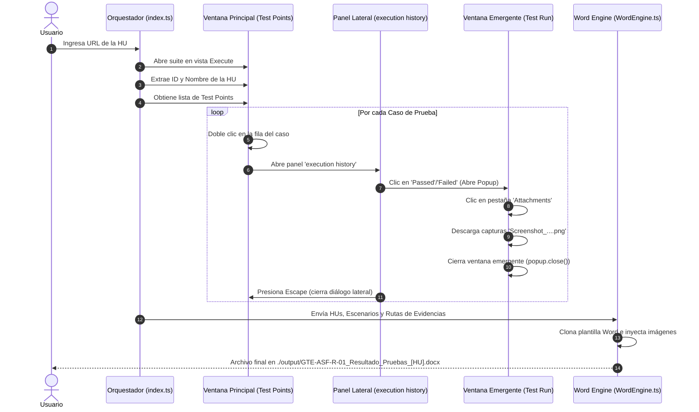

# Arquitectura de la Solución: Automatizador de Informes de Pruebas (GTE-ASF-R-01)

Este documento detalla la arquitectura técnica y el flujo de navegación de Playwright basado en la grabación real de Azure DevOps.

---

## 1. Principios de la Solución

1. **Gestión de Ventana Emergente (Popup):**
   * Azure DevOps abre la vista detallada de la corrida mediante un evento de `popup` al hacer clic en el resultado dentro del diálogo de `execution history`.
   * El bot escucha explícitamente `page.waitForEvent('popup')` para interactuar con la ventana correcta.
2. **Descarga desde la Pestaña `Attachments`:**
   * Las evidencias se encuentran centralizadas en la pestaña `Attachments` del popup de la corrida.
   * Se descargan directamente sin necesidad de desplegar pasos individuales de forma frágil.
3. **Persistencia de Sesión Corporativa:**
   * El navegador utiliza `.browser-session` (`launchPersistentContext`) para preservar la sesión de Microsoft Azure AD / SSO sin almacenar contraseñas ni tokens en el código.

---

## 2. Diagrama de Secuencia del Flujo



---

## 3. Estructura del Código Fuente

```text
src/
├── browser.ts         # Manejo del navegador persistente (.browser-session)
├── azure-extractor.ts # Flujo de navegación Playwright (Popup, Attachments y descarga)
├── word-engine.ts     # Generador OpenXML Word con redimensionamiento DrawingML
├── types.ts           # Interfaces de TypeScript
└── index.ts           # Punto de entrada CLI
```
